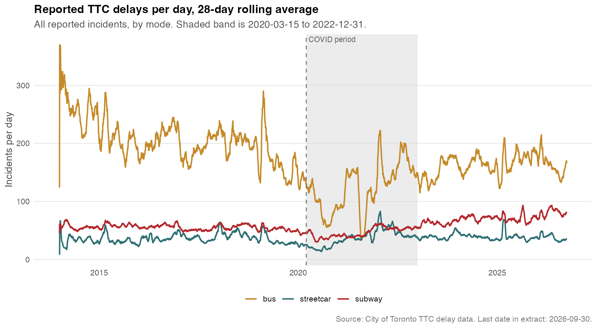
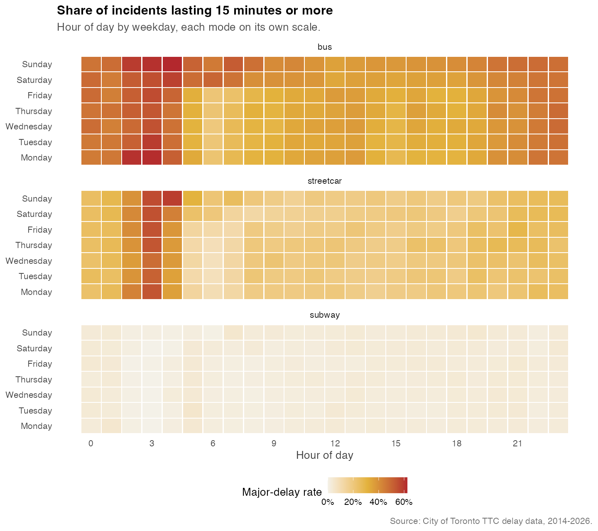
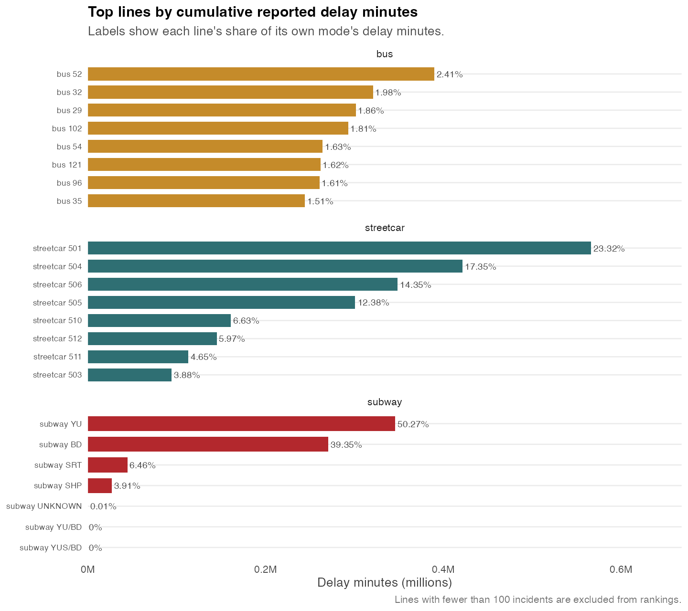

```{r setup, include=FALSE}
knitr::opts_chunk$set(echo = FALSE, warning = FALSE, message = FALSE)
library(readr)
library(dplyr)
library(scales)

key <- read_csv("../outputs/tables/findings_key_numbers.csv",
                show_col_types = FALSE)
k <- function(metric) {
  as.numeric(key$value[key$metric == metric])
}
pct <- function(x, digits = 1) paste0(format(round(x, digits), nsmall = digits), "%")
num <- function(x) format(round(x), big.mark = ",", scientific = FALSE)
```

```{css, echo=FALSE}
body { max-width: 900px; margin: auto; line-height: 1.55; color: #222; }
h1, h2, h3 { color: #8f1d22; }
.lead { font-size: 1.08rem; }
.small { color: #666; font-size: 0.9rem; }
img { max-width: 100%; }
```

## Headline

**Reported TTC delay is overwhelmingly a bus problem, and serious delays are
worst overnight.** Bus accounts for `r pct(k("bus_share_of_incidents_pct"))`
of the `r num(k("total_incidents"))` reported incidents and
`r pct(k("bus_share_of_delay_pct"))` of all reported delay minutes in the
extract. The share of incidents lasting 15 minutes or more is
`r pct(k("overall_major_delay_rate_pct"))` overall, and the early-morning
hours have the highest severity rate on bus and streetcar. This is a
descriptive and predictive analysis, not a causal one.

## What the data cover

The extract runs from `r key$value[key$metric == "first_date"]` to
`r key$value[key$metric == "last_date"]` and contains
`r num(k("total_incidents"))` incidents across subway, bus, and streetcar.
The pipeline downloads the City of Toronto's yearly files and the rolling
since-2025 extract, harmonises two legacy schemas and one newer schema, and
loads the result into PostgreSQL. Full method notes are in
`docs/STATISTICAL_METHODS.md`; limitations are in `docs/LIMITATIONS.md`.

## Three pictures

### 1. Daily volume: the pandemic, then a partial recovery

```{r fig1, out.width="100%", fig.cap="28-day rolling average of reported incidents per day, by mode."}

```

The shaded COVID period is visible in all three modes. Daily counts recovered
after 2022, but the series still shows the reporting disruption around the
pandemic. The last point may reflect a partial month in the rolling extract.

### 2. Major delays concentrate overnight

```{r fig2, out.width="100%", fig.cap="Share of incidents lasting 15 minutes or more, by weekday and hour."}

```

The heatmap is the clearest operational result. Bus and streetcar severity is
highest between roughly midnight and 05:00, not during the afternoon peak.
The logistic model agrees: hour 3 has an odds ratio of
`r round(k("hour3_or"), 2)` relative to midnight, while the PM peak is lower
than midnight. Subway severity stays low throughout the day.

### 3. Delay minutes sit on a small set of streetcar lines, not on a small set of bus lines

```{r fig3, out.width="100%", fig.cap="Top lines by reported delay minutes."}

```

The top 10 bus lines account for `r pct(k("bus_top10_line_share_pct"))` of bus
delay minutes. The top 5 streetcar lines account for
`r pct(k("streetcar_top5_line_share_pct"))`. YU and BD together account for
`r pct(k("subway_yu_bd_share_of_delay_pct"))` of subway delay minutes. A
network-wide bus fix is therefore a different problem from a line-specific
streetcar fix.

## What predicts a major delay

The pre-registered logistic model (15-minute outcome, trained 2014-2023,
scored on 2024) reaches an AUC of `r round(k("logistic_auc"), 3)` (95% CI
`r round(k("logistic_auc_low"), 3)` to `r round(k("logistic_auc_high"), 3)`).
That is useful but not precise. On the 2024 holdout the mean predicted
probability is `r pct(100 * k("mean_predicted_holdout"))` against an observed
rate of `r pct(100 * k("observed_holdout_major_rate"))`, so the model
under-predicts severity in that year.

Plant/infrastructure causes have higher odds of a major delay than equipment
(odds ratio `r round(k("plant_or"), 2)`). Subway has much lower odds than bus
(`r round(k("subway_or"), 3)`). The count model finds lower daily incident
counts during COVID (rate ratio `r round(k("nb_covid_rate_ratio"), 2)`) and on
weekends. The year term is `r round(k("nb_year_rate_ratio"), 3)`.

## Three recommendations for service planners

1. **Treat overnight recovery as a distinct operating problem.** The
   severity peak is between midnight and 05:00 on bus and streetcar. That
   points to recovery time, access to vehicles and staff, and terminal
   conditions, not just afternoon congestion.
2. **Separate the bus and streetcar strategies.** Bus delay is spread across
   many lines, so line-by-line targeting will miss most of it. Streetcar
   delay is concentrated: 501, 504, 506, 505, and 510 carry most of the
   streetcar delay minutes.
3. **Fix the measurement before using delay minutes as a KPI.** Legacy bus
   and streetcar files use coarse cause labels, and 1,233 records contain a
   999-minute placeholder. Changing the codebook and removing sentinel values
   would make year-over-year comparisons more trustworthy.

## Limitations

The data are observational and contain no ridership, weather, construction,
or staffing. Cause categories are coarse before 2021. The final month of the
rolling extract may be partial. The 2024 holdout is one year and is harder
than the training period. All results are associations, not causal effects.
The full list is in `docs/LIMITATIONS.md`.

## Data and reproducibility

Data: City of Toronto Open Data, TTC Subway, Bus, and Streetcar Delay Data,
Open Government Licence - Toronto. Code: `ttc-delay-analysis`, MIT licensed.
The pipeline is `Rscript scripts/run_all.R` or `make pipeline`. Generated
tables and figures are in `outputs/`; the complete findings are in
`docs/FINDINGS.md`.
